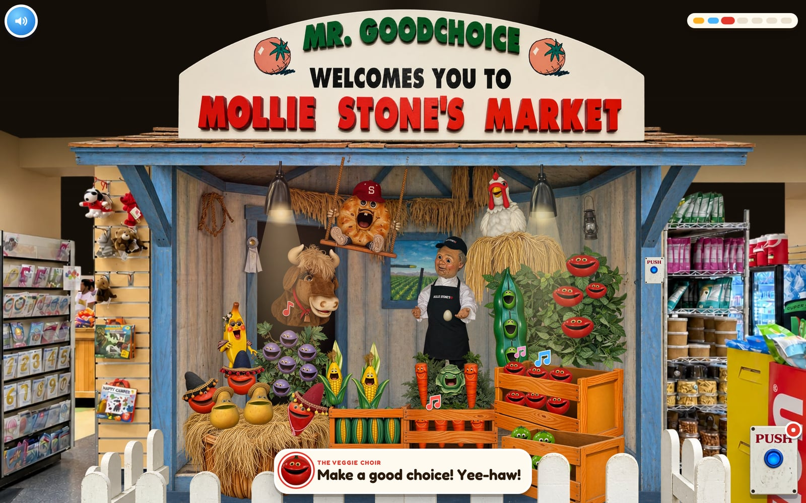
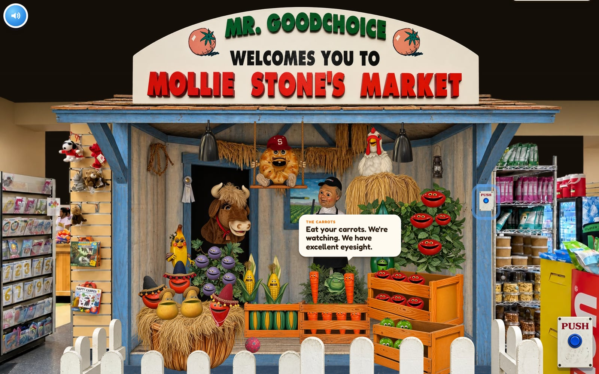
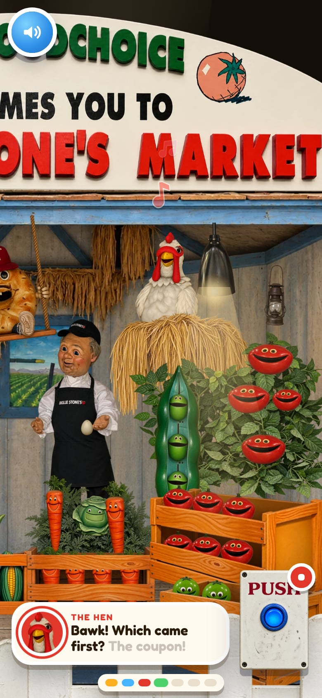

# Mr. Goodchoice welcomes you to Mollie Stone's Market

> The produce has formed a band. Your grocery bill still does not include a cover charge.

[](https://davidyen1124.github.io/mr-goodchoice/)

**Push the button: <https://davidyen1124.github.io/mr-goodchoice/>** (sound on)

## What is this?

Mollie Stone's Market has an animatronic farm stand in it. A small man in an apron, Mr. Goodchoice, stands in the
middle. Around him are a bull, a hen, a bagel on a swing, and a few dozen fruits and vegetables with faces. On the
post there is a button marked PUSH.

This repo is that farm stand as a web page. It fills the whole screen, like the apps small children already use
better than you do. Tap any character and they tell you a joke. Press the big blue PUSH button and the produce
performs *Make a Good Choice (The Mollie Stone's Hoedown)*: Mr. Goodchoice calls it like a square dance, the veggie
choir sings the chorus, and the bull, the hen, the bagel, the banana, the peppers and the grapes get a line each.
Subtitles show who is singing, and the words light up as they are sung.

Every picture on this page is a real screenshot of the site.

## How to use

1. Turn the sound on. The splash screen asks nicely.
2. Press play. Mr. Goodchoice says howdy and tells you to push the big blue button. He will bring it up again.
3. Tap anyone. They each have a joke or two. Tap the hen and she lays an egg, which leaves to the sound of a slide
   whistle. The lamps swing, the ball bounces, and the bagel gets a push.
4. Push the button. You get 91 seconds of hoedown, an egg laid on cue, and confetti.
5. Push it again to stop. Or wait. The song ends, the lights go off, and everyone goes back to breathing quietly.

If nobody touches anything for about five seconds, a white cartoon glove slides in and taps the button, or one
of the band, to show you how. It will keep doing this.



On a phone the camera follows whoever is singing. Swipe to look around.



For anyone with a keyboard: Space, Enter or P pushes the button, and M mutes.

## The band

| Who | Head count | Sample of their work |
|---|---|---|
| **Mr. Goodchoice** | 1, holding 1 egg | "Fresh eggs! Well... egg. Singular." |
| **The Bull** | 1 | "Nobody ever pets the bull." |
| **The Hen** | 1 | "Cluck around and find out." |
| **The Bagel** | 1, on a swing, in a baseball cap | "I'm on a roll! Well. Technically I'm boiled." |
| **The Banana** | 1, in sunglasses | "Shades on. Peel off." |
| **Los Peppers** | 3, in hats | "Ay caramba! Too spicy!" |
| **The Grapes** | 6 | "Stop, you'll make us raisins!" |
| **The Tomatoes** | 10 | "Hey, we're a fruit! Look it up!" |
| **The Carrots** | 6 | "Eat your carrots. We're watching. We have excellent eyesight." |
| **The Corn** | 2 | "I'm all ears!" |
| **The Pears** | 2, in straw hats | "We make a great pear!" |
| **The Limes** | 5 | "The lime-light! Finally!" |
| **The Peas** | 3, sharing 1 pod | "We're three peas in a pod. Duh!" |
| **The Cabbage** | 1 | "Lettuce be friends! Wait. I'm a cabbage." |

That is 43 faces with 27 spoken lines between them, not counting the song. The puns are load-bearing.

## FAQ

**Is this the real Mr. Goodchoice?**
No. The real one is in a grocery store and has a job. This one was rebuilt from a single photo, one vegetable at a
time.

**Is that a real song?**
It is now. It was written for this page: 132 beats per minute, seven sections, and one line in which a banana says
it is a-peeling.

**Why does the band sound like a cassette?**
On purpose. The note at the top of `scripts/band.mjs` asks for "a little tinny, like a 1990s animatronic tape".
Also, the ElevenLabs key was not allowed to generate music, so every banjo roll is arithmetic.

**Where did the ceiling go? And the coolers?**
The photo has a drop ceiling, a stack of coolers and two bins of rubber balls parked in front of the stand. They
were left out on purpose. It is a stage now.

**Has he really been standing there since 1994?**
That's what he says if you keep tapping him. This repo has not checked.

**Can a four-year-old use it?**
That was the idea. The world fills the screen with no web page around it, there are two chunky buttons, and every
tap sparkles. Added to a phone's home screen it runs full screen.

## What's inside

- **One photo.** Everything starts from a single photo of the real stand, `assets-src/ref/scene.jpg`.
  [`assets-src/art/manifest.mjs`](assets-src/art/manifest.mjs) lists every element in it and where it sits.
  `scripts/crops.mjs` cuts each one out.
- **Every element is its own image.** The store, the booth, the sign, each character, the crates and the fence were
  recreated one by one with Codex CLI's built-in `image_gen` (the imagegen skill), each from its crop of the photo
  (`scripts/gen.mjs`). Every singer has a second frame with the other mouth position, made by editing the first.
  The crates have separate front panels, so the produce peeks out between the slats. The store without its ceiling
  is another edit. `scripts/clean.mjs` trims the images, lines each second frame up with its first so that swapping
  them never jitters, and writes `public/img/*.webp`: 57 sprites, about 5 MB.
- **The voices** are ElevenLabs (eleven_v3, with timestamps): 13 voices, pitch-shifted with ffmpeg, and four of
  them at once for the choir. The character timings that come back with the audio become the karaoke captions and a
  lip-sync track at 30 frames per second (`scripts/song.mjs`). You need an ElevenLabs API key to regenerate them,
  and you do not need one to run the site.
- **The band** is not ElevenLabs. That key has no `music_generation` permission, so the banjo rolls, boom-chick
  guitar, upright bass, fiddle, kazoo and washboard are rendered in code by `scripts/band.mjs`, along with the
  cowbell, the slide whistle, the boing and the ka-ching. The voices are then placed on its bars.
  `node scripts/song.mjs --probe` asks whether the key can use the Music API yet.
- **The page** (`src/`) is plain JS and [GSAP](https://gsap.com) on a 2000×1500 stage that matches the photo's
  framing. [`src/layout.js`](src/layout.js) has every actor's box. There is no canvas and no framework: the stand
  is 67 absolutely positioned pieces, and a camera that scales the stage to cover any screen and pans on narrow
  ones.
- **The cue sheet** (`src/data/song.json`) is what the page plays from: who sings when, every word with its
  timing, the mouth track, and the cues for the egg, the cowbell, the jumping peppers and the confetti.
- **The small things.** Between shows everybody breathes a little out of step and twitches now and then. Music
  notes rise from whoever is singing. The tutorial glove is a Codex image too. The subtitle avatars are cut from
  the sprites (`scripts/avatars.mjs`) and the app icons from the tomato (`scripts/icons.mjs`). People who ask for
  reduced motion get less dancing and less confetti.
- **QA.** `scripts/qa.mjs` drives the page in Chromium or WebKit on a desktop, an ultrawide monitor, a tablet and
  a phone both ways up, and makes more than 200 checks, including that the bull is on screen when the bull sings.
  `scripts/parity.mjs` draws the stage 1:1 and scores it against the photo, region by region.

## Run it locally

```bash
npm install
npm run dev        # http://localhost:5391
npm run build      # static site in dist/
npm run qa         # the end-to-end checks; needs `npm run dev` running (screenshots go to qa/)
```

The committed sprites, audio and cue sheets are enough to run and build the site. `?skip` skips the splash screen,
and `?parity` draws the stage 1:1 for comparing with the photo (the photo itself is not deployed).

The generators are optional. Run them from the repo root:

```bash
node scripts/crops.mjs                   # the photo -> assets-src/art/crops, one crop per element
node scripts/gen.mjs [--force] [name…]   # (re)generate art with Codex image_gen -> assets-src/art/raw
node scripts/clean.mjs                   # assets-src/art/raw -> public/img
node scripts/avatars.mjs                 # subtitle avatars from the sprites
node scripts/icons.mjs                   # favicon, home-screen and manifest icons
node scripts/song.mjs                    # song, click lines, sound effects, cue sheets
node scripts/parity.mjs [url]            # renders the stage 1:1 and diffs it against the photo -> qa/
node scripts/qa.mjs [url] [--webkit]     # end-to-end QA on desktop, ultrawide, tablet and phones -> qa/
node scripts/fps.mjs [url]               # frame rate on the real GPU (opens a Chromium window)
```

Art generation needs the Codex CLI. Voice generation needs an `ELEVENLABS_API_KEY` in the environment, and
`ffmpeg`. Generation logs, the voice cache, QA output, build output and dependencies are not in Git.

## Where things live

```
index.html      the page
src/            the app: main.js, layout.js (every actor's box), style.css, data/ (cue sheets, sprite sizes)
public/         shipped as-is: img/ (sprites), audio/ (the song, the click lines, the sound effects), icons
scripts/        the asset pipeline and the QA scripts
assets-src/     source material the site does not ship
  ref/          the photo of the real stand, and the measuring overlays drawn on it
  art/          manifest.mjs (every element and its prompt), crops/ (cut from the photo), raw/ (generated images)
docs/           the screenshots in this README
```

## Deploying

Pushing to `main` runs [a GitHub Actions workflow](.github/workflows/pages.yml) that builds with Vite and publishes
`dist/` to GitHub Pages. The build uses relative paths (`base: './'`), so it works under `/mr-goodchoice/` or
anywhere else.

## Disclaimer

This is a fan-made tribute. It is not affiliated with, endorsed by, or sponsored by Mollie Stone's. The real
Mr. Goodchoice does not need a browser. Go and see him, and buy something while you are there.
