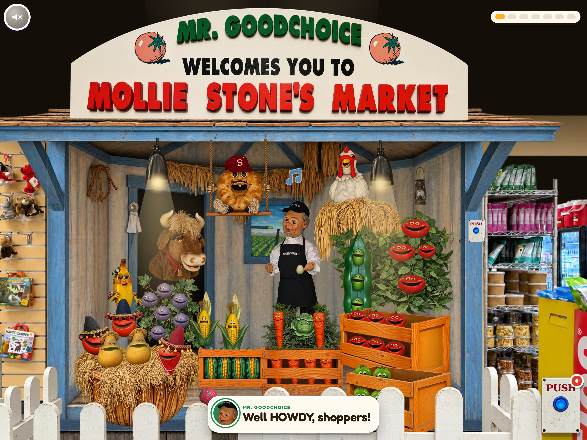
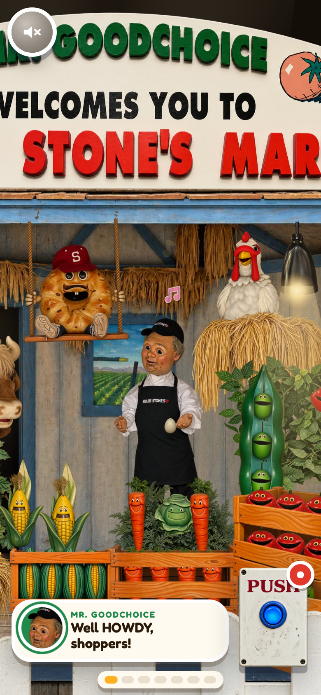

# Mr. Goodchoice welcomes you to Mollie Stone's Market

The produce has formed a band. Your grocery bill still does not include a cover charge.

A full-screen, kids-app style recreation of the Mr. Goodchoice farm-stand animatronic at Mollie Stone's Market
(`ref/scene.jpg`). Tap any character and they tell you a joke; press the big blue PUSH button and the produce
performs *Make a Good Choice (The Mollie Stone's Hoedown)*: Mr. Goodchoice calls it like a square dance, the
veggie choir sings the chorus, the bull, the hen, the bagel, the banana, the peppers and the grapes each get a
verse, with subtitles that show who is singing.

## Screenshots

The real local show, captured at 2× resolution using the committed sprites, audio,
and cue sheets. Desktop keeps the full farm stand; the phone camera follows the singer.





It behaves like the apps kids already know (Toca Boca, Sago Mini, Bluey): the world fills the screen with no
web page around it, there are only two chunky buttons, a cartoon glove shows what to tap when nobody has
touched anything for a while, every tap sparkles, music notes rise from whoever sings, and on a phone the
camera follows the singer (swipe to look around). Added to the home screen it runs full screen
(`public/manifest.webmanifest`). The store's ceiling and the merchandise in front of the booth are left out
on purpose.

## How it was made

- **Every element is its own image.** The elements of the photo (the store, the booth, the sign, each character,
  the crates, the fence…) were recreated one by one with Codex CLI's built-in `image_gen`
  (the imagegen skill), each from its crop of the photo (`art/manifest.mjs`, `scripts/crops.mjs`,
  `scripts/gen.mjs`). Every singer has a second frame with the other mouth position, made by editing the first,
  and the crates have separate front panels so the produce peeks out between the slats. The store without its
  ceiling (`store-bg-noceiling`) is another edit.
  `scripts/clean.mjs` trims them, registers each second frame onto its first and writes `public/img/*.webp`.
- **The song** (`scripts/song.mjs`) is voiced by ElevenLabs (eleven_v3, with timestamps) using the key in
  `../audio-anchors/.env`. That key has no `music_generation` permission, so the band (banjo, fiddle, kazoo,
  upright bass, washboard, slide whistle) is rendered in code by `scripts/band.mjs` and the voices are placed on
  its bars. The script writes the cue sheet the page plays from: who sings when, the words with their
  timings (karaoke captions) and a lip-sync track built from ElevenLabs' character timings.
  `node scripts/song.mjs --probe` says whether the key can use the Music API yet.
- **The page** (`src/`) is plain JS + GSAP on a 2000×1500 stage that matches the photo's framing
  (`src/layout.js` has every actor's box). A camera scales it to cover any screen and pans on narrow ones.
  The tutorial glove (`hand`) is a Codex image too; the subtitle avatars are cut from the sprites
  (`scripts/avatars.mjs`) and the app icons from the tomato (`scripts/icons.mjs`).

## Commands

```bash
npm run dev            # http://localhost:5391 (vite)
npm run build
node scripts/gen.mjs [--force] [name…]   # (re)generate art with Codex image_gen
node scripts/clean.mjs                   # art/raw -> public/img
node scripts/avatars.mjs                 # subtitle avatars from the sprites
node scripts/icons.mjs                   # favicon, home-screen and manifest icons
node scripts/song.mjs                    # song, click lines, sound effects, cue sheets
node scripts/parity.mjs [url]            # renders the stage 1:1 and diffs it against the photo -> qa/
node scripts/qa.mjs [url] [--webkit]     # end-to-end QA on desktop, ultrawide, tablet and phones -> qa/
node scripts/fps.mjs [url]               # frame rate on the real GPU (opens a Chromium window)
```

`?skip` skips the intro, `?parity` draws the stage 1:1 for diffing (the photo itself is not deployed).

## Fresh checkout

```bash
npm ci
npm run dev
```

The committed sprites, audio, and cue sheets are enough to run and build the website. The optional art and
voice generators are development tools: art generation uses Codex, and voice regeneration can use an
`ELEVENLABS_API_KEY` supplied through the environment. The existing song script also has a local sibling
project fallback; that project's credentials are not part of this repository. Audio regeneration requires
`ffmpeg`. Generation logs, voice caches, QA output, build output, and dependencies are excluded from Git.
